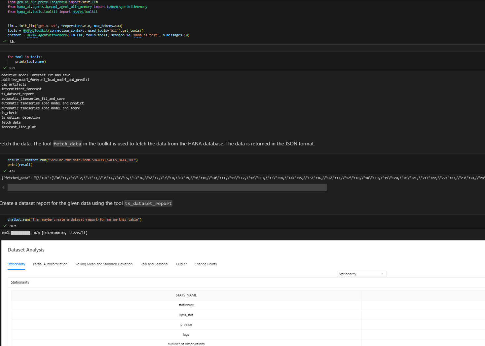
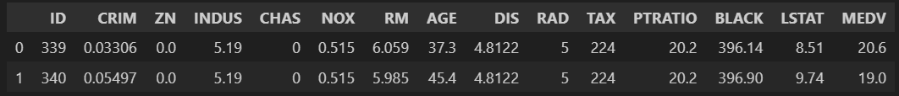

Generative AI Toolkit for SAP HANA Cloud
========================================

Welcome to Generative AI Toolkit for SAP HANA Cloud (hana.ai)!

This package enables the users to access SAP HANA data and build various machine
learning models using the data directly in SAP HANA via natural language. This page provides an overview of hana.ai.

Generative AI Toolkit for SAP HANA Cloud consists of five main parts:

  - AI tools, which provides a set of tools to analyze data and build machine learning models.
  - HANA Vector Store and Knowledge Base API, which provides a way to store and retrieve vectors and knowledge bases.
  - Smart DataFrame, which is a HANA dataframe Agent to interact with HANA data.
  - ContextAgent, which provides the recommended way to interact with the AI tools via natural language using Markdown-backed memory and runtime skill routing.
  - MCP server, which exposes the toolkit's tools (including the HANA object discovery and data retrieval tools) over either stdio or HTTP transport with structured audit context.

Prerequisites
-------------

  - **Python** 3.10 or higher. Install ``hana_ai`` and any required optional
    features explicitly (``hana_ai[nlp]``, ``hana_ai[graph]`` or ``hana_ai[all]``).
    Package imports do not install missing dependencies.

  - **SAP HANA Python Driver** : hdbcli. Please see `SAP HANA Client Interface Programming Reference
    <https://help.sap.com/docs/SAP_HANA_CLIENT/f1b440ded6144a54ada97ff95dac7adf/f3b8fabf34324302b123297cdbe710f0.html>`_
    for more information.

  - **SAP HANA PAL** : Security **AFL__SYS_AFL_AFLPAL_EXECUTE** and
    **AFL__SYS_AFL_AFLPAL_EXECUTE_WITH_GRANT_OPTION** roles. See `SAP HANA
    Predictive Analysis Library
    <https://help.sap.com/docs/hana-cloud-database/sap-hana-cloud-sap-hana-database-predictive-analysis-library/sap-hana-cloud-sap-hana-database-predictive-analysis-library-pal>`_
    for more information.

  - **SAP HANA APL** 1905 or higher. See
    `SAP HANA Automated Predictive Library Developer Guide
    <https://help.sap.com/viewer/product/apl/latest/en-US>`_
    for more information. Only valid when using the APL package.

  - **Python Machine Learning Client for SAP HANA**: ``hana-ml>=2.29.26072000,<3``
    is installed as a runtime dependency of ``hana_ai``.
    For more details, refer to the `Documentation <https://help.sap.com/doc/cd94b08fe2e041c2ba778374572ddba9/latest/en-US/hana_ml.html>`_.

  - **SAP-AI-SDK-GEN** for generative AI hub integration: opt in using
    ``pip install "hana_ai[all]"``. The SDK is not part of the default install.
    For comprehensive instructions, see the `SAP Help Documentation on Using SAP-AI-SDK-GEN <https://help.sap.com/doc/generative-ai-hub-sdk/CLOUD/en-US/_reference/README_sphynx.html>`_.

  - Ensure that you have access to generative AI hub and deployed models in SAP Business Technology Platform. For more information, see the `Create a Deployment for a Generative AI Model <https://help.sap.com/docs/sap-ai-core/sap-ai-core-service-guide/create-deployment-for-generative-ai-model-in-sap-ai-core>`_.

ContextAgent with HANAML Toolkit
--------------------------------

HANAML Toolkit is a set of tools to analyze data and build machine learning models using the data directly in SAP HANA. It can be consumed by ContextAgent. cc is a connection to a SAP HANA instance. ::

    from hana_ai.agents.context_agent import ContextAgent
    from hana_ai.tools.toolkit import HANAMLToolkit

    tools = HANAMLToolkit(connection_context=cc, used_tools='all').get_tools()
    chatbot = ContextAgent(llm=llm, tools=tools, storage_dir=".context_agent")

ContextAgent currently supports workflow skills for dataset preparation, time-series profiling, forecasting, prediction-result analysis, outlier inspection, grouped forecasting, model lifecycle operations, and dataframe-oriented fallback steps.

``used_tools='all'`` does not enable Python execution or include the separate SQL
agent. Select tools and HANA privileges for the intended workflow: model training,
storage and deletion can require write/execute privileges. The SQL agent's
read-only checks do not apply to those tools. See :doc:`changlog` for the security
defaults and migration notes.

ContextAgent also supports command-style controls during chat calls:

- Memory commands: ``!clear_notes``, ``!clear_session``, ``!reset_memory``, ``!clear_notes_file``, ``!clear_todo``, ``!clear_decisions``, ``!clear_context``, ``!clear_chat``, ``!clear_summary``
- Skill commands: ``!list_skills``, ``!active_skills``, ``!skills_on``, ``!skills_off``, ``!enable_skill <skill_name>``, ``!disable_skill <skill_name>``

HANA Vector Store and Knowledge Base API
----------------------------------------

Create Knowledge Base for hana-ml codes in HANA Vector Engine. ::

    from hana_ai.vectorstore.hana_vector_engine import HANAMLinVectorEngine

    hana_vec = HANAMLinVectorEngine(connection_context=cc, table_name="hana_vec_hana_ml_knowledge")
    hana_vec.create_knowledge()

Create Code Template Tool and Add Knowledge Bases to It
-------------------------------------------------------

Create a code template tool and add knowledge bases to it. ::

    from hana_ai.tools.code_template_tools import GetCodeTemplateFromVectorDB

    code_tool = GetCodeTemplateFromVectorDB()
    code_tool.set_vectordb(vectordb=hana_vec)

Create HANA Dataframe Agent and Retrieve Templates
--------------------------------------------------

The legacy dataframe agent is deprecated; prefer ContextAgent for new workflows.
It requires explicit tools by default. This example retrieves code templates; it
does not execute Python or generate report files. ::

    from hana_ai.agents.hana_dataframe_agent import create_hana_dataframe_agent

    hana_df = cc.table("MY_DATA")
    agent = create_hana_dataframe_agent(
        llm=llm, df=hana_df, tools=[code_tool], verbose=True
    )
    agent.invoke("Retrieve example code for a dataset report. Do not execute it.")

For report generation or model operations, register the corresponding dedicated
tools with ContextAgent. Python/REPL execution is disabled by default; the explicit
trusted-code opt-in is not a sandbox and must not be exposed to untrusted callers.

Smart DataFrame
---------------

Smart DataFrame is a HANA dataframe Agent to interact with HANA data. ::

    from hana_ai.smart_dataframe import SmartDataFrame

    sdf = SmartDataFrame(dataframe=hana_df)
    sdf.configure(llm=llm)
    new_df = sdf.transform(question="Get first two rows")
    new_df.collect()

``transform()`` accepts a single read-only SELECT/WITH query generated by the
model. Unsafe statements and embedded semicolons are rejected; one trailing
statement terminator is removed. This validation does not restrict the database
privileges of other tools available through ``ask()``.
